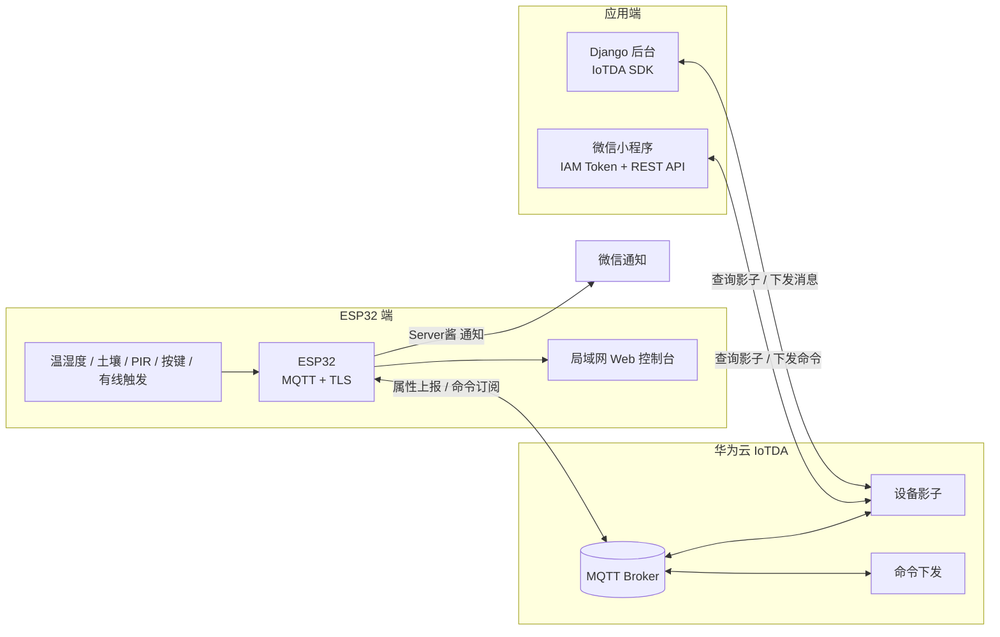

# ESP32 + 华为云 IoT 智能家居

一个从端到云再到应用的完整物联网项目：ESP32 采集温湿度、土壤、人体感应和门磁/有线触发信号，通过 **MQTT over TLS** 接入 **华为云 IoTDA**；微信小程序和 Django 后台都可以查看设备影子、下发控制命令；ESP32 本身还提供一个局域网 Web 控制台。

> 仓库中的固件、小程序和后台代码均已做脱敏处理：Wi-Fi 密码、设备密钥、华为云 AK/SK、IAM 账号密码、邮箱授权码和 Server酱 SendKey 均已改为环境变量或占位符。**请勿把真实凭据提交到公开仓库。**

## 系统架构



## 功能

### ESP32 固件
- Wi-Fi + NTP 对时，使用设备 ID / 设备密钥动态生成 MQTT 用户名和密码（HMAC-SHA256）
- MQTT over TLS 连接华为云 IoTDA，订阅 `$oc/devices/{device_id}/sys/commands/#`
- 周期上报温度、湿度、土壤湿度、PIR、LED、喇叭、按键、开锁次数、有线触发状态
- 云端命令：`SetLED`、`SetLock`、`SetSpeaker`，并返回标准 `request_id` 命令应答
- 本地联动：PIR 触发 LED、按键切换喇叭、有线触发开锁、土壤湿度检测
- 局域网 Web 控制台：自适应手机/桌面，提供 `/api/data`、`/api/cmd` 接口
- 可选 Server酱微信通知

### 微信小程序
- 通过华为云 IAM 获取 `X-Subject-Token`
- 查询设备影子，展示上报属性
- 通过滑块设置参数并下发命令
- 适合作为设备调试和演示入口

### Django 后台
- 用户注册/登录、个人中心、论坛等页面
- 使用华为云 IoTDA Python SDK 查询设备影子、下发设备消息
- 展示温度、湿度、电量等数据
- MySQL 数据库 + Bootstrap 前端

## 目录结构

```text
.
├── firmware/
│   └── smart_home/
│       ├── smart_home.ino        # ESP32 主程序
│       └── secrets.example.h     # 凭据模板（复制为 secrets.h）
├── miniprogram/
│   ├── config.js                 # IAM / IoTDA 配置模板
│   ├── pages/Huawei_IOT.*        # 设备影子与命令页面
│   └── project.config.json
├── server/
│   ├── manage.py
│   ├── school/                   # Django 配置
│   ├── login/ home/ fourm/       # 业务应用
│   ├── person/ presonal_center/
│   ├── requirements.txt
│   └── .env.example
└── README.md
```

## 硬件与引脚

| 功能 | ESP32 引脚 | 说明 |
|------|------------|------|
| PIR 人体感应 | GPIO36 (A0) | 数字输入 |
| 按键 | GPIO35 (A3) | 数字输入 |
| 土壤湿度 | GPIO34 (A2) | ADC 输入 |
| LED | GPIO4 (A4) | 数字输出 |
| 无源喇叭 | GPIO2 (D2) | PWM 输出 |
| 电磁锁 | GPIO16 (D9) | 脉冲输出 |
| 有线触发 | GPIO27 (D7) | 上拉输入，低电平触发 |

> 引脚定义以 `firmware/smart_home/smart_home.ino` 顶部宏为准；不同 ESP32 开发板的 `A0/A3` 映射可能不同，接线前请核对板卡丝印。

## 快速开始

### 1. ESP32 固件

1. 安装 Arduino IDE / Arduino CLI 和 ESP32 开发板支持。
2. 安装依赖库：`ArduinoJson`（v7）、ESP32 自带 `WiFi`、`WiFiClientSecure`、`mbedtls`。
3. 复制 `firmware/smart_home/secrets.example.h` 为 `firmware/smart_home/secrets.h`，填入：
   - Wi-Fi SSID / 密码
   - 华为云设备 ID、设备密钥、MQTT 接入地址
   - 可选：Server酱 SendKey
4. 打开 `smart_home.ino` 编译并下载。
5. 串口波特率 `115200`，启动后可看到 Wi-Fi、NTP、MQTT 连接日志和本机 IP。

详细说明见 [`firmware/README.md`](firmware/README.md)。

### 2. 微信小程序

1. 用微信开发者工具导入 `miniprogram/`。
2. 修改 `config.js` 中的 IAM 用户名/密码/账号名、项目 ID、设备 ID 和 IoTDA 应用侧地址。
3. 在 `project.config.json` 中填入自己的小程序 AppID。
4. 开发阶段可在开发者工具中勾选“不校验合法域名”；上线前需在微信公众平台配置华为云域名白名单。

详细说明见 [`miniprogram/README.md`](miniprogram/README.md)。

### 3. Django 后台

```bash
cd server
python -m venv .venv
# Windows: .venv\Scripts\activate
# Linux/macOS: source .venv/bin/activate

pip install -r requirements.txt

# 配置环境变量（不要把 .env 提交到 git）
set DJANGO_SECRET_KEY=change-me
set MYSQL_DATABASE=school
set MYSQL_USER=root
set MYSQL_PASSWORD=your-password
set HUAWEI_CLOUD_AK=your-ak
set HUAWEI_CLOUD_SK=your-sk
set HUAWEI_PROJECT_ID=your-project-id
set HUAWEI_DEVICE_ID=your-device-id

python manage.py migrate
python manage.py runserver
```

详细说明见 [`server/README.md`](server/README.md)。

## 关键技术点

- **设备侧 MQTT 鉴权**：华为云要求 `clientId = {device_id}_0_0_{yyyyMMddHH}`、`username = device_id`、`password = HMAC-SHA256(时间戳, 设备密钥)`；固件没有依赖完整 MQTT 库，而是手写了 CONNECT/PUBLISH/SUBSCRIBE 报文，便于理解协议细节。
- **命令应答**：从命令 topic 的 `request_id` 中解析请求 ID，按华为云规范回复 `$oc/devices/{device_id}/sys/commands/response/request_id={id}`。
- **本地 Web 控制台**：ESP32 同时作为 HTTP 服务器，手机和电脑访问同一局域网 IP 即可控制，不依赖公网。
- **端云协同**：设备属性变化后主动上报；云端命令执行后再主动上报一次，保证设备影子最终一致。

## 安全说明

这是一个课程/作品集项目，以下问题在生产环境中需要修正：

- 固件使用 `tls.setInsecure()` 跳过服务器证书校验，生产环境应内置华为云 CA 证书并启用校验。
- 小程序直接在客户端使用 IAM 用户名/密码换取 token，凭据会暴露在客户端；生产环境应由自己的后端代理鉴权，小程序只拿短期 token。
- Django 示例中的登录逻辑使用明文密码比较，仅用于课程演示；生产环境应使用 Django 自带密码哈希和权限系统。
- 原项目中的真实 Wi-Fi 密码、设备密钥、华为云 AK/SK、IAM 密码、邮箱授权码和 Server酱 SendKey 已从代码中移除。**如果这些凭据曾经被提交或分享过，请立即在对应平台轮换/删除。**

## 相关项目

- [STM32 外设实验合集](https://github.com/3265038185/stm32-peripheral-labs)
- [MATLAB 数字图像处理实验](https://github.com/3265038185/matlab-digital-image-processing)
- [PCB 设计与蓝桥杯信号源实验](https://github.com/3265038185/hardware-design-portfolio)
